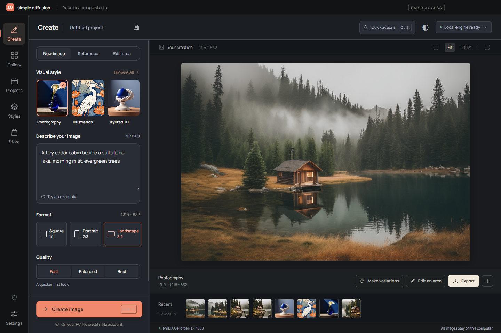

# Simple Diffusion

**Pick a style. Describe it. Create.**

A Windows desktop studio for private, local image generation. Your prompts and images stay on your PC. Basic local generation is free, with no image credits or account requirement.

## Releases

[Official downloads and release notes](https://github.com/ProsperTechnology/simple-diffusion/releases)

Public release preparation is in progress. No signed public installer or automatic-update feed has been published yet. Do not download builds from impersonator accounts.

## In the studio

- Photography, Illustration and Stylized 3D starter styles
- Image-reference variations and painted-area corrections
- Projects, local gallery and PNG/JPEG export
- A pack store with free Warm Light recipe installation; paid collections are in development
- An updater designed to verify signed release manifests and Windows-signed installers

The current engine uses SDXL 1.0. Windows 10/11 x64, a supported NVIDIA GPU with at least 8 GB VRAM, 16 GB system RAM and sufficient disk space are required. Tested on an RTX 4080 / 16 GB; broader hardware coverage is still pending. Model download is separate.

## Privacy and purchases

Generation runs locally. Model setup needs an internet connection. When configured and enabled, update checks contact GitHub; update files download only when chosen. GitHub can receive ordinary connection information such as your IP address. No prompts or images are sent with update checks.

Starter styles remain free. The pack storefront currently supports included and free recipe collections. Paid checkout is not connected, no payment is collected, and prices have not been set.

## About this repository

This is the official distribution and product-information repository for Prosper Technology. Application source is maintained privately and is not published here. No open-source license for the application is granted by this repository. Third-party components retain their respective licenses. Simple Diffusion contains no Fooocus application source and claims no affiliation or performance superiority.

Please do not include private images, prompts, license keys or personal system paths in public issues.
